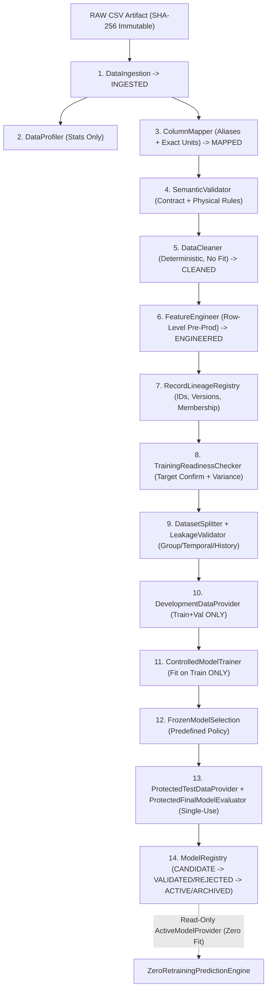

# Pipeline Architecture — `iron_manufacturing`

## 1. Hierarchical Contract & Package Structure
TaqaMind enforces a clean separation between the authoritative Shared Core (`src/taqamind/core/`) and domain packages (`src/taqamind/domains/iron_manufacturing/`):

```
DomainContract (iron_manufacturing v1.0.0)
 ├── ProcessContract (eaf_meltshop)
 │    └── IndustrialTaskContract (eaf_metallic_waste_loss_prediction)
 │         └── DatasetContract (eaf_meltshop_heat_waste)
 ├── ProcessContract (rebar_hot_rolling)
 │    └── IndustrialTaskContract (rebar_rolling_waste_quantity_prediction)
 │         └── DatasetContract (rebar_rolling_lot_waste)
 └── ProcessContract (scrap_yard_reception)
      └── IndustrialTaskContract (scrap_delivery_contaminant_prediction)
           └── DatasetContract (scrap_yard_delivery_contaminant)
```

Package layout under `src/taqamind/domains/iron_manufacturing/`:
- `domain.py` — Domain contract assembly and `register_iron_manufacturing(registry)`.
- `config.py` — Constants, limits, ambiguous headers, configurable local paths.
- `common/` — Verified unit conversions (`units.py`), bilingual EN/AR normalization & safe CSV I/O (`normalization.py`), SHA-256 hashing (`hashing.py`), and deterministic synthetic fixtures (`synthetic.py`).
- `processes/` — Isolated process contracts, physical validators, and deterministic pre-production feature engineering (`eaf_meltshop.py`, `rebar_hot_rolling.py`, `scrap_yard_reception.py`).
- `adapters/` — Thin Core audit mitigation wrappers (`_store.py`, `unit_mapper.py`) plus protocol-compatible local adapters strictly for Shared Core P1.6–P1.8 gaps (`readiness_and_splitting.py`, `training_registry.py`, `data_access.py`, `modeling.py`, `model_registry.py`). Shared Core P1.1–P1.5 engines (`LocalDatasetArtifactStorage`, `LocalModelArtifactStorage`, `LocalDatasetRegistry`, `LocalRecordLineageRegistry`, `CsvDataIngestion`, `PandasDataProfiler`, `DeterministicColumnMapper`, `ContractSemanticValidator`, `ContractDataCleaner`, `DeterministicFeatureEngineer`, `TabularPreprocessor`) are wired directly from `taqamind.core.*`.
- `services/` — Application orchestration strictly separating training (`training_service.py`) from zero-retraining inference (`prediction_service.py`), plus lineage resolution (`lineage_service.py`) and template export (`templates.py`).
- `pipeline.py` & `cli.py` — High-level `IronManufacturingPipeline` facade and lightweight CLI (`python -m taqamind.domains.iron_manufacturing.cli`).

## 2. End-to-End Stage Flow



## 3. Factory Isolation & Security Controls
- Every artifact key, registry JSON, partition slice, split manifest, lineage namespace, and active model pointer is strictly partitioned by `factory_id: UUID`.
- Cross-factory access raises `ArtifactScopeError`, `RegistryScopeError`, `RegistryNotFoundError`, or `DataAccessDeniedError`.
- No raw factory data is transmitted to external LLM services; all column mappings are deterministic and require explicit approval for aliases, manual overrides, and unit conversions.
- Spreadsheet export sanitizes formula-injection prefixes (`=`, `+`, `-`, `@`).
